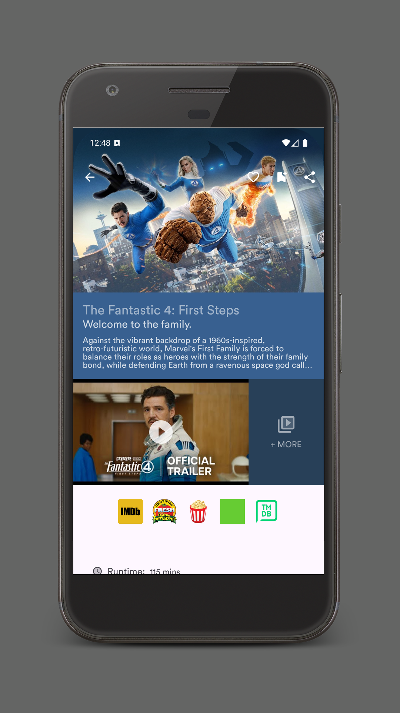
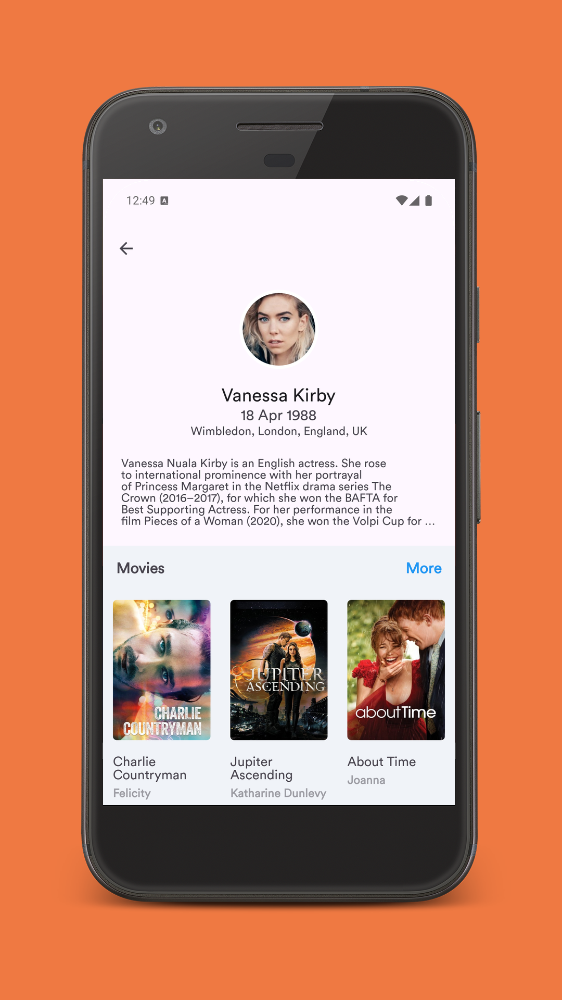
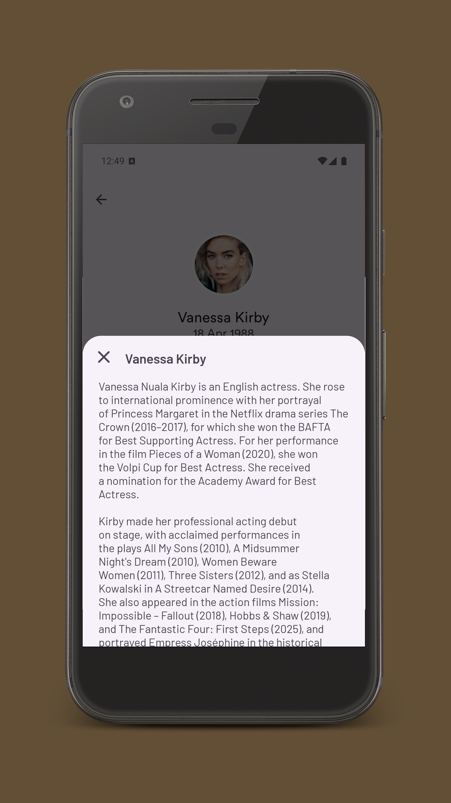
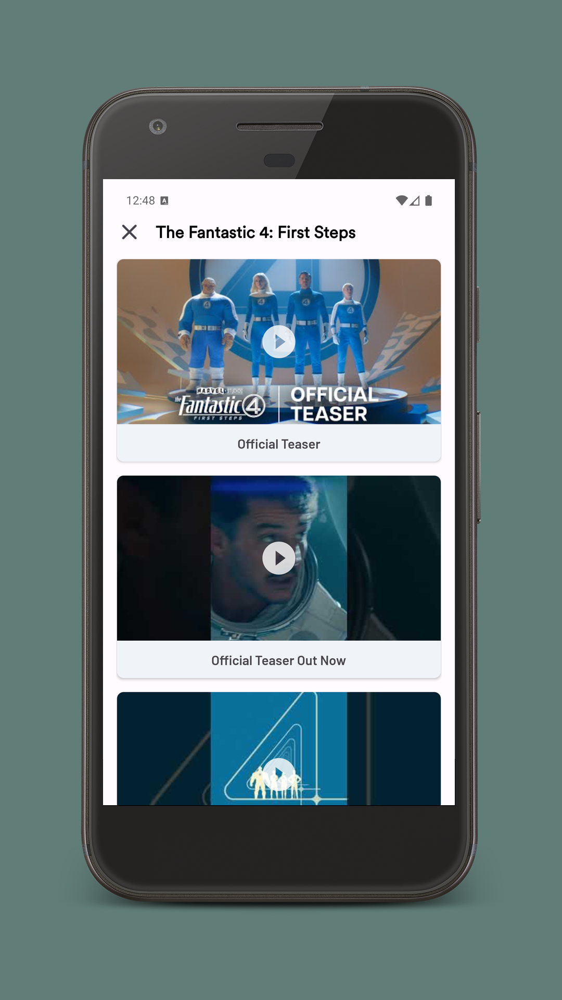
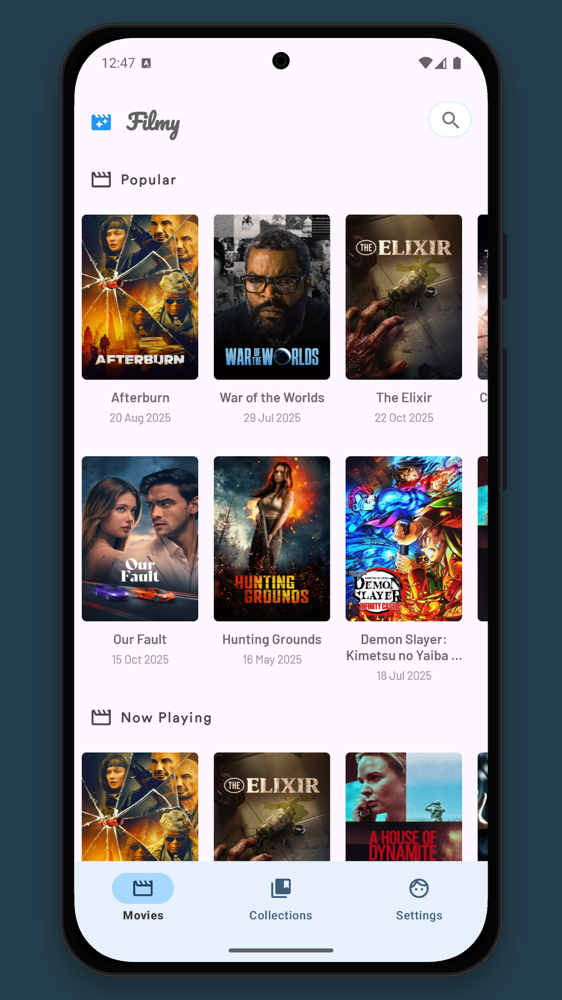

---

# 🎬 Filmy

An open-sourced, beautifully material-designed **movie app** powered by TMDB.

---

## 📱 Screens

  
  
  
  
  
  

---

## ⚙️ APIs

Filmy is powered by **The Movie Database (TMDB)** API.

---

## 💡 Implementations

This project contains advanced API integrations and modern Android patterns that make it a high-quality app.

- TBD

---

## 🧩 Prerequisites

Generate your own API keys from the following sources:

- [TMDB](https://www.themoviedb.org/documentation/api)
- [YouTube Data API](https://developers.google.com/youtube/v3/getting-started)
- [OMDB](https://www.omdbapi.com/apikey.aspx)

---

## 📲 Get It On Google Play

---
